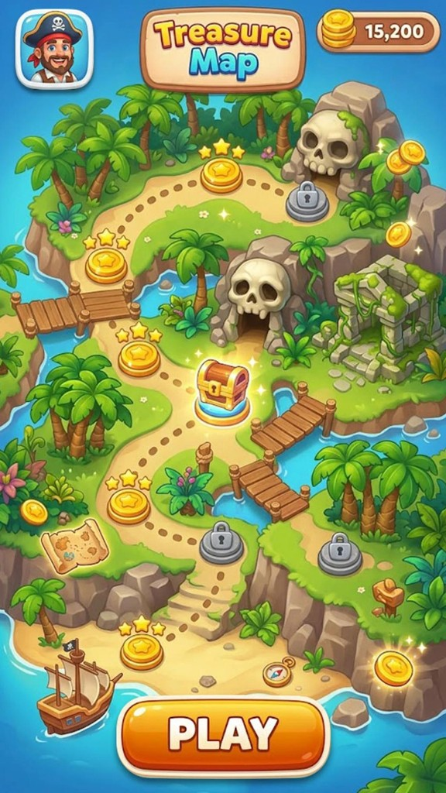
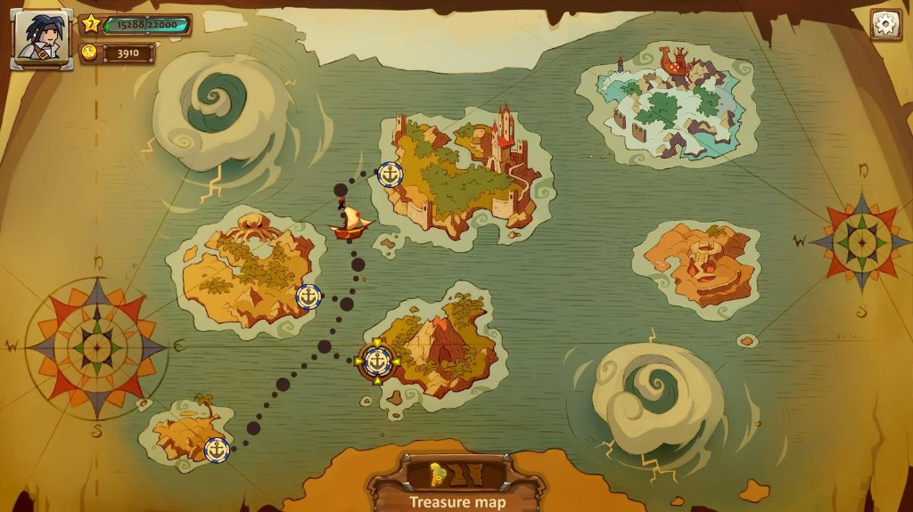
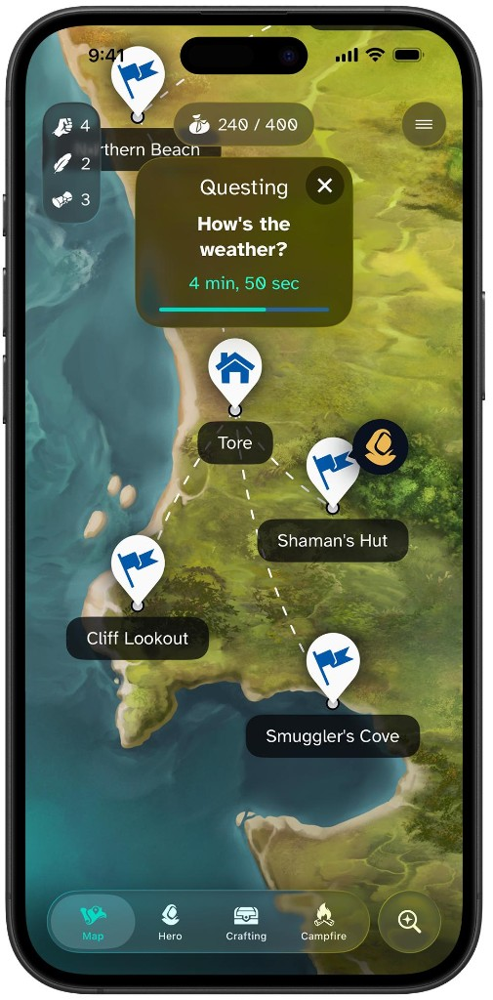

# LootBox Phase 2: UI/UX Redesign Brief

This brief combines the full review of the Phase 1 build into one document. It is organised by topic rather than by the order the feedback arrived. Every point from the review is kept; code locations are added so each item maps to a real screen.

---

## 1. The core message

The product is much further along than a typical prototype. The information architecture is coherent and the core game loop is present. It is not final yet.

The biggest issue is not missing pages. The UI still feels like a **functional prototype or dashboard**, not a **polished consumer rewards product**.

### The rule for Phase 2

> Do not add new features. Do not change the backend architecture. Take the existing application and perform a complete mobile-first UI/UX redesign, with the Mystery Box, Mystery Map, Vault, Daily and Home treated as premium game experiences rather than dashboard cards. Replace emoji-heavy UI with a consistent icon/illustration system, create strong visual hierarchy, improve financial clarity, add polished animations and reward reveals, and optimize specifically for 375-430px screens and less tech-savvy users.

No Seasons, no more games, no more features. The existing loop is enough:

> Box → Map → Collections → Vault → Daily → Progress → Rewards

The goal is to make that loop feel **beautiful, exciting, trustworthy, and extremely easy to understand**.

### Current scores

| Area | Score |
| --- | --- |
| Product architecture | 8/10 |
| Information architecture | 8/10 |
| Feature completeness | 8.5/10 |
| Financial UX | 7/10 |
| Game UX | 6.5/10 |
| Visual polish | 5.5/10 |
| Mobile consumer feel | 6/10 |
| Current "wow" factor | 4.5/10 |

The weakest scores (wow factor, visual polish, mobile feel, game UX) are exactly what Phase 2 targets. The strong scores (architecture, features) are why the backend should not be touched.

---

## 2. Priority order

### Fix before launch

1. Make the visual design much more premium
2. Improve the Home screen dramatically
3. Make the Mystery Box experience visually exciting
4. Make the Map actually look and feel like a map
5. Fix the confusing financial terminology
6. Improve the Daily page hierarchy
7. Make rewards and collections visually compelling
8. Remove demo-looking inconsistencies
9. Improve mobile navigation and hierarchy
10. Add proper empty, loading, success and reveal states

### Then improve

- Progress
- Referrals
- Wallet
- Account
- Accessibility and older-user usability
- Micro-interactions and animations

---

## 3. Product identity: Explore, not gamble

The product is heavily branded "LootBox" and uses the words Mystery Box, rewards, odds, spins, prizes, vault, deposits and withdrawals. Together these can make it feel closer to a loot-box or gambling product than the broader **reward adventure platform** it actually is.

The mechanics do not need to change, but the branding and UI should emphasise:

> **Explore → Discover → Collect → Unlock**

rather than:

> Deposit → Gamble → Win

This distinction matters enormously for how the product is perceived. It also informs the odds presentation (section 7.3) and the naming question, which is still open.

---

## 4. Global design system

### 4.1 Premium visual foundation (Phase A)

Establish, before touching individual screens:

- typography
- spacing
- card system
- buttons
- iconography
- colors
- shadows
- borders
- responsive behavior
- mobile canvas
- accessibility

### 4.2 Replace emojis with an icon and illustration system

This is the single easiest visual upgrade. The UI currently leans on 🎁 🗺️ 🏛️ 🎯 🌊 🧭 🪙 🔑 📜 🛕 🐚. They were fine for prototyping but make the product look less polished.

- **Lucide icons** for utility UI
- **Custom illustrations** for the games
- **Custom item artwork** for collections
- **Custom artwork** for the map, the vault and the boxes

Keep emojis only where they genuinely add personality.

### 4.3 Illustration set (the biggest visual investment)

About 10-15 core illustrations would transform the product:

- Mystery Box
- 9 individual boxes
- Lost Island map
- Beach
- Jungle
- Ancient Ruins
- Temple
- Vault
- Daily Spin
- Tide Pool
- Collection book
- Empty collection
- Streak
- Reward celebration
- Treasure/reward chest

### 4.4 Accessibility for older Malaysian users

For a broad Malaysian audience, including older users, simplify considerably.

**Always explain jargon.** Don't rely on "XP", "Relics", "Fragments", "Deposit Level" or "Withdrawable" without a plain explanation next to them:

| Term | Plain explanation |
| --- | --- |
| Withdrawable | Money you can withdraw now |
| Pending Rewards | Rewards still being reviewed |
| Credits | Game credits used to play |

The terms can stay, as long as they are always explained.

**Touch targets:** buttons should be big, at least about 48px.

**Plain, scannable language.** Instead of:

> "Collect 8 relics, the Ancient Map and a Temple Key to open it."

write:

> Collect 8 relics + the Ancient Map + 1 Temple Key to unlock the Temple.

### 4.5 Navigation

Current bottom navigation (`src/components/app/bottom-navigation.tsx`):

```
Home | Play | Progress | Referrals | Account
```

Daily is hidden inside Home, even though it is a core retention mechanic. Referrals is secondary. Change to:

```
Home | Play | Daily | Progress | Account
```

Move Referrals into Account, or make it a prominent card on Home or Account.

### 4.6 Top header: money is always one tap away

The header currently shows only `🪙 26,500` (Credits), and Wallet is not in the primary navigation. Show both balances, and make tapping them open Wallet:

```
RM1,250   (withdrawable)
26,500    (Credits)
```

### 4.7 States and polish (Phase F)

- animations and micro-interactions
- loading states
- empty states
- success states
- error states
- confirmation modals
- reduced motion support
- mobile testing at 375, 390 and 430px widths

---

## 5. Home (`src/app/app/page.tsx`)

The biggest opportunity. Home already contains the right information: Withdrawable RM1,250, Cash RM500, Credits 26,500, Pending RM45, Daily Spin, Missions, Map progress, Vault progress, Tomorrow teaser and Play. Structurally that's good.

But it reads like a **financial dashboard**. Home should feel like "Something exciting is waiting for me", not "Here are my account balances."

### New hierarchy

Current order: greeting, name, streak, then four money figures first.

New order:

```
Good morning, Daniel 👋
🔥 11 Day Streak

[ HERO CARD ]
🌊 Something is waiting...
Tide Pool Treasure
Something washed ashore today.
[ Explore ]

Your rewards
  Withdrawable  RM1,250
  Credits       26,500

Today's progress
  Spin ✓
  Missions 2/3
  Map 5/44

Continue your journey
  Map   → 5/44
  Vault → 0/3 Keys
```

### Visual hero card

The current "The Temple is waiting" section is text-heavy. It should be a **large visual card with artwork**. This is one of the biggest missing pieces:

```
┌───────────────────────────┐
│       [Temple artwork]    │
│    THE TEMPLE             │
│    IS WAITING             │
│    8 relics collected     │
│    Ancient Map ✓          │
│    Temple Key 0/1         │
│    [ Continue Exploring ] │
└───────────────────────────┘
```

The page should feel like a game or reward experience, not an e-wallet.

---

## 6. Play hub (`src/app/app/play/page.tsx`)

Structure is correct (Mystery Box, Mystery Map, Vault, Collections, Box History), but it looks like a list of cards. The three games are the three major experiences and should feel like **three destinations**:

| Destination | Visual | Status line | Button |
| --- | --- | --- | --- |
| Mystery Box | Large illustrated card | "Choose 1 of 9", "From 2,000 Credits" | Open a Box |
| Mystery Map | Large island artwork | "5 / 44 discovered" | Explore Island |
| Vault | Locked vault artwork | "0 / 3 Keys" | View Vault |

The current page tells users what the games are. The new page should make them want to tap.

---

## 7. Mystery Box (`src/app/app/play/mystery-box/page.tsx`, `src/components/app/mystery-box.tsx`, `reward-reveal.tsx`)

The signature mechanic and the one needing the most game-design polish. It should be **one of the most visually impressive screens in the app**. Functionality is correct; presentation is not.

### 7.1 The grid

Today the boxes are mostly `?` and numbers 1-9. Replace with a real 3 × 3 grid of illustrated crates. Each crate has:

- a 3D or illustrated appearance
- a subtle idle animation
- hover and tap response
- selected glow
- selected bounce
- the other 8 boxes dim and lock
- an opening animation
- a reward reveal animation

### 7.2 Opening sequence

```
Tap → 8 boxes fade/dim → selected box pulses → box shakes
    → lid opens → light/reward emerges → reward card
```

### 7.3 Reward screen

Not just "RM150 reward". Instead:

```
        ✨
    YOU FOUND
      RM150
   Rare Reward
     +150 XP
 [ Collect Reward ]
```

Then, if applicable: **Collection progress +1**. This turns a transaction into an experience.

### 7.4 Odds and cost

Transparent odds are good, but listing all probabilities directly under the boxes makes it feel like a gambling interface.

- Move odds behind a **"View prizes & odds"** link.
- Present it cleanly as "Prize pool. Every box has the same odds."
- Make the real money cost obvious next to the Credits price, using RM1,000 = 60,000 Credits:

```
8,000 Credits
≈ RM133.33
```

---

## 8. Mystery Map (`src/app/app/play/map/page.tsx`, `src/components/app/map.tsx`)

Currently the **weakest visual experience**, even though the concept is excellent. It reads as a checklist:

```
Lost Island  5/44
Beach → Jungle → Ancient Ruins → Temple
Beach 1, Beach 2, Beach 3...
```

It should become an actual map where the user **sees the journey**, not just "5/44 tiles":

```
        TEMPLE 🔒
            │
     Ancient Ruins 🔒
            │
         Jungle 🔒
            │
         Beach
     ●──●──●──●
     ●  ●  ●  ●
```

The map should show:

- discovered tiles
- undiscovered tiles
- current location
- locked regions
- special areas
- paths
- treasure markers
- the Temple
- the Vault
- progress

This could become the **visual identity of the whole product**.

### Reference images

A winding path with star nodes, locked nodes and a treasure chest:



An illustrated sea chart with separate islands (regions), anchor waypoints, a dotted route and a ship marking the current location:



A mobile map with painted terrain, named location pins and dashed paths:



What they share: real terrain artwork, a visible route between points, clear locked versus unlocked markers, and a sense of where you are now.

---

## 9. Vault (`src/app/app/play/vault/page.tsx`, `src/components/app/vault-card.tsx`)

Structure is correct (3 keys, 8 fragments, Temple Treasures 5/5, the reward inside) but it reads as an information page. **The Vault should look locked.**

```
ANCIENT VAULT
[ large vault door artwork ]

0 / 3 Keys
0 / 8 Seal Fragments
0 / 5 Temple Treasures

( progress ring: 0% )

🔒 Vault Locked   (disabled)
```

When complete:

```
✨ VAULT READY
[ OPEN THE VAULT ]
```

That transition should be a **major reward moment**.

### Confirmation before consuming items

Keys and fragments are consumed on unlock, so a strong confirmation modal is required:

```
Unlock Ancient Vault?

This will use:
  3 Vault Keys
  8 Seal Fragments
  Temple Treasures

These items will be consumed.

[ Unlock Vault ]
```

Very important.

---

## 10. Collections (`src/app/app/collections/`, `src/components/app/collection.tsx`)

The system is good (Lost Island Relics, Temple Treasures, fragments, special items, keys), but collecting must be visual. Make it feel like a **collection book**, not text rows:

```
LOST ISLAND RELICS            1 / 10

[item] [item] [item] [item] [item]
[item] [item] [item] [item] [item]

████░░░░░░ 10%
8 relics → Temple
```

Each missing item shows:

- a silhouette
- a locked state
- its rarity
- where it can be found

This creates the "I need to find that one" feeling.

### Clarify the 8 of 10 rule

The Lost Island collection has 10 relics but only 8 are needed for the Temple. It's an interesting mechanic, but it must be stated explicitly:

> 8 of these 10 relics are required to unlock the Temple.

Otherwise users wonder why 8/10 appears to be enough.

---

## 11. Daily (`src/app/app/daily/page.tsx`, `daily-cards.tsx`, `daily-actions.tsx`)

The features are right (streak, milestone timeline, check-in, spin, odds, 3 missions, mystery event, daily discoveries, tomorrow teaser) but too much competes for attention.

### New order: a daily ritual

1. **🔥 11 Day Streak**, "3 days until 14-day reward"
2. **Daily Spin**: large wheel, FREE, [ SPIN ]
3. **Today's Missions**: "2 / 3 completed", three visual mission cards
4. **Today's Mystery**: large illustrated event card
5. **Free Discoveries**: "0 / 3 remaining"
6. **Tomorrow**: teaser

> Check in → Spin → Missions → Mystery → Explore

### Fix the streak milestone display

The page shows "11 day streak", "Longest: 14 days" and "3 more days to Two week explorer". Technically fine, but the milestones render as fragments: `3d / 7d / 14 / 14d / 30 / 30d`. Replace with one clean bar:

```
🔥 11 days
3 ───── 7 ───────── 14 ───────── 30
3 days to your next reward
```

---

## 12. Progress (`src/app/app/progress/page.tsx`, `src/components/app/progression.tsx`)

Overloaded: XP, Deposit Level, collections, achievements, statistics, recent XP and achievement progress make one long scrolling data page. Split the hierarchy:

```
Level 2 - Beachcomber
265 XP
██████░░░░
35 XP to Explorer
```

Then:

1. **Achievements**: 3-4 cards
2. **Collections**
3. **Statistics**

Move **Deposit Level** into Wallet or Account, or shrink it to a small section.

### Make the Deposit Level and money link explicit

"Higher daily withdrawal limit" is the key phrase: it ties Deposit Level directly to money. Explain the actual rules clearly.

The numbers are consistent (Bronze, RM1,000 total deposits, RM1,000 more to Silver, and Silver starts at RM2,000). But the UI must consistently say **cumulative qualifying deposits**, not just "deposits".

---

## 13. Money screens

### 13.1 Wallet (`src/app/app/wallet/page.tsx`, `wallet-summary.tsx`, `transaction-list.tsx`)

Solid structure (Withdrawable, Cash Wallet, Credits, Pending Rewards, pending transactions, ledger explanation), but it looks too much like a bank, and the **terminology is confusing**.

Entries like:

```
-RM1,100 Pending
+RM1,100 Withdrawable
```

can make an older or less financially confident user ask: "Where did my money go?"

Add a simple visual explanation:

```
Your money

Withdrawable   RM1,250   Available to withdraw
Cash           RM500     Available to convert into Credits
Pending        RM45      Under review
```

Then a prominent **How it works** flow:

> Deposit → Cash → Credits → Play → Reward → Pending → Withdrawable

### 13.2 Convert (`src/app/app/wallet/convert/page.tsx`, `convert-form.tsx`)

Already clean, and it clearly states RM1,000 = 60,000 Credits. Add a summary:

```
You are converting   RM500
You will receive     30,000 Credits
Value                RM500

[ Convert RM500 → 30,000 Credits ]
```

"You receive 0 Credits" before any input looks unfinished; replace it with a proper empty state.

Also show **"Credits cannot be converted back into Cash."**, if that is the actual rule.

### 13.3 Deposit (`src/app/app/wallet/deposit/page.tsx`, `deposit-form.tsx`)

Functional, and it explains manual bank transfer well. Improve Malaysian usability by making the transfer details dominant:

```
TRANSFER TO
Maybank
LootBox Rewards Sdn Bhd
5140 1234 5678
[ Copy Account Number ]
```

Then a lighter form: **After transferring**, with Amount, Reference, Sender name and Proof. The current form is too dense and "banking form".

**Reference fix:** do not tell users to use their referral code as the transfer reference unless that is genuinely the reconciliation mechanism. The deposit reference should be a **unique, system-generated deposit reference**. (The Maybank payment account's seeded instructions in `scripts/seed.ts` currently say "Use your LootBox referral code as the transfer reference.")

### 13.4 Withdraw (`src/app/app/wallet/withdraw/page.tsx`, `withdraw-form.tsx`)

Good basics. Before the user submits, show a review summary:

```
You're withdrawing   RM500
To                   Maybank, Daniel Wong, •••• 5566
Processing           Usually within X business days
Fee                  RM0 / RMX
After withdrawal     Remaining withdrawable: RM750

[ Request Withdrawal ]
```

This makes the transaction safer and easier to understand.

---

## 14. Referrals (`src/app/app/referrals/page.tsx`, `referral-card.tsx`)

Functionally complete (Levels 1-3, pending vs settled, qualifying deposit, 72-hour hold, fraud rules) but reads administratively. Refocus on:

```
Your referral link
3X74K3QX
[ Copy Link ]

Your network
1 Direct friends · 0 Level 2 · 0 Level 3

Your earnings
RM0 Pending · RM0 Earned

How it works
You → Friend → Friend → Friend
```

The detailed rules can stay lower on the page.

---

## 15. Account (`src/app/app/account/page.tsx`)

Acceptable but very plain. Add an identity header:

```
Daniel Wong
Level 2 · Beachcomber
🔥 11 day streak
```

Then grouped settings:

| Group | Items |
| --- | --- |
| Personal | Profile, Verification |
| Money | Wallet, Bank Accounts, Payment Details |
| Security | Password, Sessions |
| Preferences | Notifications, Responsible Play |
| Help | Support, FAQ, Help Centre |

If the navigation change goes ahead, Referrals also lives here (see 4.5).

---

## 16. Demo data must not look fake

Explicitly demo entries appear in the UI, for example **"Vault reward (demo)"** and **"Pending reward (demo)"** (from `scripts/seed.ts`), and Wallet activity shows several reward settlement entries.

Fine for development, but **never expose "demo" in the normal production UI**. Either create a proper Demo Mode, or seed realistic data only in development.

---

## 17. Implementation plan

Do not rebuild the app. The backend and product architecture are substantially in place. Work in this order:

| Phase | Scope |
| --- | --- |
| A. Design system | Typography, spacing, cards, buttons, iconography, colors, shadows, borders, responsive behavior, mobile canvas, accessibility |
| B. Core experiences | Home, Mystery Box, Mystery Map, Vault, Daily |
| C. Progression | Collections, Progress, Referrals |
| D. Finance | Wallet, Deposit, Convert, Withdraw |
| E. Account | Account, Support, Notifications |
| F. Polish | Animations, loading, empty, success and error states, confirmation modals, reduced motion, mobile testing at 375/390/430px |

---

## 18. Open decisions

These need an answer before or during Phase 2:

1. **Name and branding.** Keep "LootBox", or rename to support the Explore, Discover, Collect, Unlock identity?
2. **Credits to Cash.** Confirm Credits can never be converted back to Cash, so the Convert page can say so.
3. **Withdrawal terms.** The real processing time ("within X business days") and the fee (RM0 or an amount) for the Withdraw summary.
4. **Deposit reference.** Confirm a system-generated deposit reference replaces the referral code instruction.
5. **Illustration source.** Commission artwork, generate it, or use a licensed illustration pack for the 10-15 core illustrations.
6. **Referrals placement.** Inside Account, or as a prominent card on Home.
7. **Demo data.** A visible Demo Mode, or development-only seed data.
